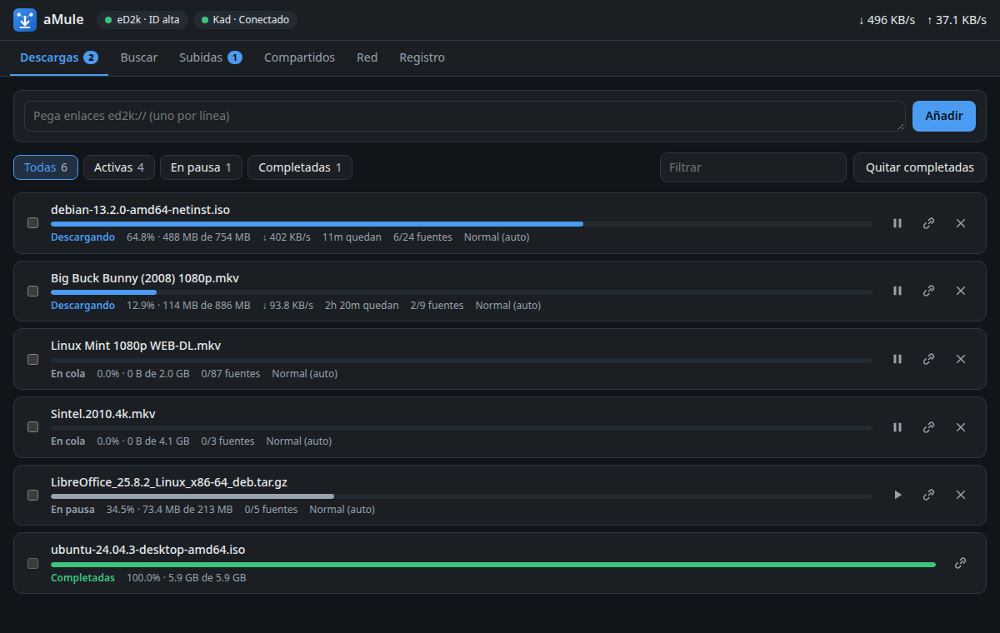

# aMule for Home Assistant

Share and download files on the eD2k and Kad networks from Home Assistant. This repository has:

- **The aMule app** (add-on): aMule 2.3.3 with a new web UI in the Home Assistant sidebar.
- **The aMule integration** (HACS): sensors, switches, speed limits and an action to add links,
  for dashboards and automations.



## Features

- **Transfers**: progress, speed, time left and sources for every download; pause, resume,
  cancel or change priority one by one or in bulk; paste several `ed2k://` links at once.
- **Search** eD2k (all servers or the current one) or Kad, filtered by type, extension, size
  and sources. Sort the results and download several with one click.
- **Uploads**, **shared files**, **network** (eD2k and Kad on/off, server list, high/low ID with
  hints, statistics, speed limits) and the **aMule log**.
- Works on phones, follows the light/dark theme, in English and Spanish.
- No passwords to manage: access goes through Home Assistant.

## Installation

### App

1. In Home Assistant, go to **Settings → Apps → App store → ⋮ → Repositories** and add
   `https://github.com/jmanera/ha-amule`.
2. Install **aMule** and start it. Open **aMule** in the sidebar.
3. For full speed, forward **4662/TCP** and **4672/UDP** on your router to Home Assistant
   (otherwise you get a *low ID*).

See [`amule/DOCS.md`](amule/DOCS.md) for all options.

### Integration (optional)

1. In [HACS](https://hacs.xyz/), open **⋮ → Custom repositories** and add
   `https://github.com/jmanera/ha-amule` as an **Integration**.
2. Install **aMule** and restart Home Assistant.
3. Home Assistant finds the running app on its own: open **Settings → Devices & services** and
   click **Configure** on the discovered *aMule*.

Requires Home Assistant 2026.9 or newer.

## Home Assistant integration

| Entity | What it shows or does |
| --- | --- |
| `sensor.amule_download_speed`, `sensor.amule_upload_speed` | Current transfer rates |
| `sensor.amule_active_downloads` | Files downloading right now (attribute `downloads` lists them) |
| `sensor.amule_queued_downloads`, `…_paused_downloads`, `…_completed_downloads`, `…_failed_downloads`, `…_downloads_in_queue` | Download queue by state |
| `sensor.amule_upload_queue`, `sensor.amule_shared_files` | Clients waiting for an upload slot; files you share |
| `sensor.amule_downloaded_this_session`, `sensor.amule_uploaded_this_session` | Bytes since aMule started |
| `sensor.amule_ed2k_status`, `sensor.amule_kad_status` | `high_id` / `low_id` / `connecting` / `disconnected`, and `connected` / `firewalled` / … |
| `sensor.amule_ed2k_server`, `…_ed2k_users`, `…_kad_users`, `…_kad_nodes` | Network details (diagnostic) |
| `binary_sensor.amule_ed2k_connection`, `…_kad_connection`, `…_low_id` | Connectivity, and a problem flag for a low ID |
| `switch.amule_ed2k_network`, `switch.amule_kad_network` | Connect or disconnect each network |
| `number.amule_download_limit`, `number.amule_upload_limit` | Speed limits in kB/s (0 = unlimited) |
| `button.amule_pause_all_downloads`, `…_resume_all_downloads`, `…_clear_completed_downloads` | Bulk actions |

**Action** `amule.add_link`: adds one or more `ed2k://` links.

**Events** `amule_download_completed` and `amule_download_failed`, with `name`, `hash`, `size` and
`link`. For example, a notification when something finishes:

```yaml
triggers:
  - trigger: event
    event_type: amule_download_completed
actions:
  - action: notify.mobile_app_my_phone
    data:
      message: "Downloaded {{ trigger.event.data.name }}"
```

## How it works

The app runs `amuled` (no GUI) and a small Python service that talks to it over aMule's
*External Connections* (EC) protocol, implemented from scratch in [`src/ha_amule/ec`](src/ha_amule/ec).
The service serves the web UI through Ingress and an HTTP API that the integration polls over
the Supervisor network with a key it receives through Supervisor discovery. amuled's own web
server is not used.

## Development

```bash
make install        # dependencies and pre-commit hooks
make check          # lint, types, tests (app and integration), security audit
make demo           # whole app on http://localhost:8099 against a fake amuled with canned data
make amuled         # the real app image, with remote control on 127.0.0.1:4712 (password "dev")
make dev            # backend on :8099 against an amuled you run (AMULE_EC_HOST/PORT/PASSWORD)
make image          # build the app image
```

The integration has its own Python 3.14 environment in `integration_tests/`, pinned to a real
Home Assistant core.

## Releasing

1. Bump the version in `amule/config.yaml`, `amule/Dockerfile` (`io.hass.version`),
   `pyproject.toml`, `src/ha_amule/__init__.py` and `custom_components/amule/manifest.json`,
   and add an entry to `amule/CHANGELOG.md`.
2. Commit, then tag and push: `git tag v1.2.3 && git push origin v1.2.3`.

The *Release* workflow checks that all versions match the tag, builds the multi-arch image
(amd64, aarch64) to `ghcr.io/jmanera/ha-amule`, and publishes a GitHub release with the
changelog entry and a zip of the integration. Home Assistant offers the update to installed
apps, and HACS to the integration.

## License

[Apache 2.0](LICENSE). aMule itself is GPL-2.0 and comes from Debian's `amule-daemon` package.
